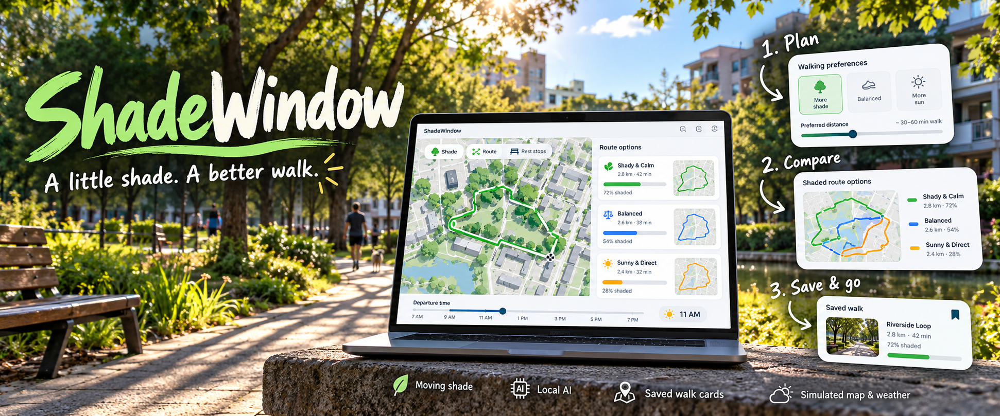

# ShadeWindow

**A little shade. A better walk.**



Find a better time for a short walk. ShadeWindow compares routes, moving shade, weather scenarios, and benches, then saves a simple walk card so you can put the screen away.

## How it works

1. **Plan.** Set your walking preferences or describe them to a local AI model.
2. **Compare.** Explore three routes and departure times, with shade calculated throughout the walk.
3. **Save & go.** Keep a walk card in your browser, or print it to take along.

SunCalc calculates the sun position; building and tree geometry determine shade. Ollama interprets requests and selects from calculated candidates using an installed Llama or Gemma model.

**This is a simulation:** the neighbourhood and weather are synthetic, with fixed demo dates of October 10–16, 2026. It does not provide real street routing or live forecasts.

## Run locally

Requires Node.js 20.11+ and npm.

```sh
npm install
npm start
```

Open [localhost:3000](http://localhost:3000). The walking controls work without AI. For **Find my window**, start Ollama with an installed Llama or Gemma model; ShadeWindow does not download weights.

Optional configuration is in [.env.example](.env.example). To use it:

```sh
cp .env.example .env
node --env-file=.env server.mjs
```

## Check

```sh
npm test
```

With the app and Ollama running, `npm run verify:ai` checks real local model calls.

## Local by default

Saved cards stay in browser storage. The interface is cached for offline reuse after its first successful load; AI still needs the local server and Ollama. Requests use the local Ollama endpoint unless you configure a remote one.

Built with plain HTML, CSS, JavaScript, Node.js, SunCalc, and Ollama. See [BUILD_PLAN.md](docs/BUILD_PLAN.md) for implementation details and [ASSET_NOTES.md](docs/ASSET_NOTES.md) for artwork credits.

The [submission draft](docs/template.md) and [publishing plan](docs/PUBLISHING.md) are in `docs/`.

[MIT License](LICENSE). SunCalc and AI model weights have their own licenses.
